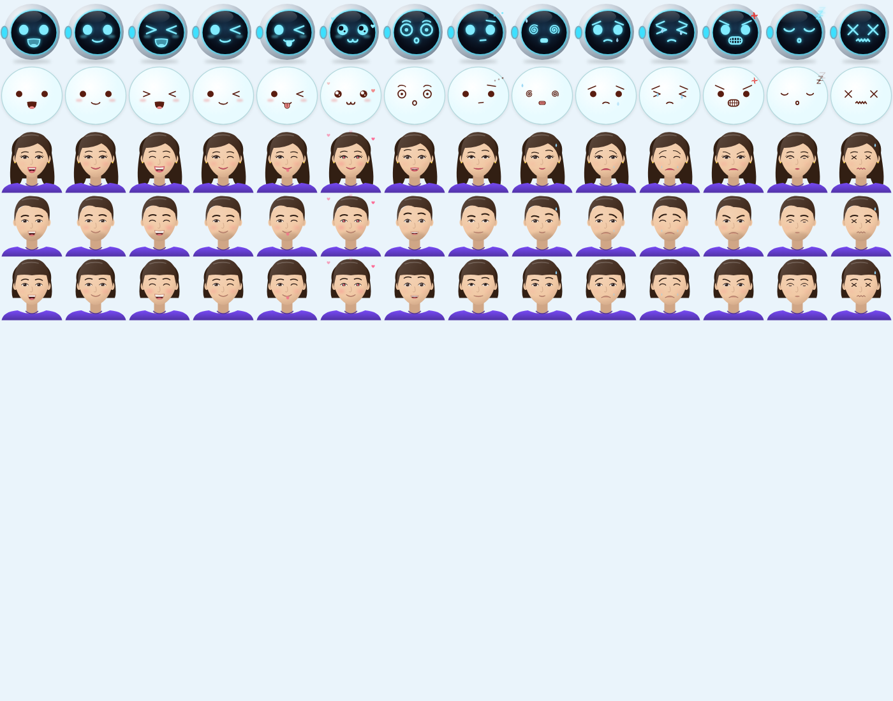

# AI Virtual Assistant

A customizable, multilingual AI voice assistant built with Flutter. It has an animated face that blinks, looks around, lip-syncs while speaking and reacts to what it says.



## Features

- **Custom name.** Rename the assistant at any time in Settings.
- **Gender.** Choose Male, Female or Gender-Neutral. This sets the default voice pitch, voice selection, hair style and how the assistant presents itself.
- **Animated face.** Three styles: a glowing **Robot Orb**, a **Kawaii** doodle face and a stylised **Human** face. You can change the skin tone, hair, eye and accent colours.
  - 14 expressions: happy, laugh, wink, playful, love, surprised, thinking, confused, sad, crying, angry, sleepy, dizzy and neutral.
  - Natural random blinking (including double blinks), eye movements, breathing and head sway.
  - Nods while talking, a curious head tilt while listening and a springy pop when the expression changes.
  - Lip-sync driven by the TTS engine's word boundaries. A procedural speech rhythm takes over on engines that don't report them.
  - Tap the face for a random reaction.
- **Voice.** Pick any installed device voice or accent, and adjust pitch, speed and volume. You can preview the voice before using it.
- **Multilingual.** The assistant detects your language (Hindi, English, Hinglish, Urdu, Spanish, French, Japanese, Chinese and 25+ more) and replies in the same language and script. Speech output switches to a matching voice automatically. You can also fix one language in Settings.
- **Personality.** Choose Friendly, Funny, Professional, Calm or Energetic.
- **Voice input.** Tap the mic and speak. Recognition uses the selected or last-used language.

## Setup

```bash
flutter pub get
flutter run
```

Open **Settings → AI Brain** and paste an Anthropic API key from https://console.anthropic.com. The key is stored only on the device. Without a key, the app runs in a limited demo mode.

The app calls the Claude Messages API (`claude-opus-5-5` by default; you can change the model in Settings). Replies stream in, and each one carries an emotion tag for the face and a language tag for the voice.

> For a production release, route API calls through your own backend rather than shipping a key in the client.

## Project layout

```
lib/
  main.dart                         app + providers
  home_page.dart                    avatar, chat, mic / text input
  settings_page.dart                all customization
  models/                           settings + emotions
  services/
    ai_service.dart                 Claude streaming client + offline demo
    conversation_controller.dart    ties AI, voice and face together
    voice_service.dart              text-to-speech, speech recognition, lip-sync signals
    language_detector.dart          offline script / word-based detection
    settings_controller.dart        persisted settings
  widgets/avatar/
    face_painter.dart               orb, kawaii and human faces (CustomPainter)
    animated_avatar.dart            blink, gaze, head motion, lip-sync, reactions
```
